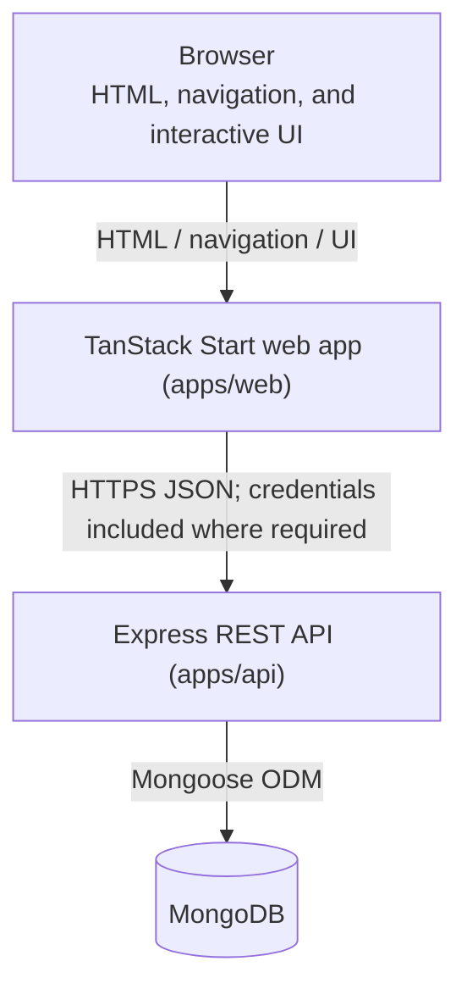
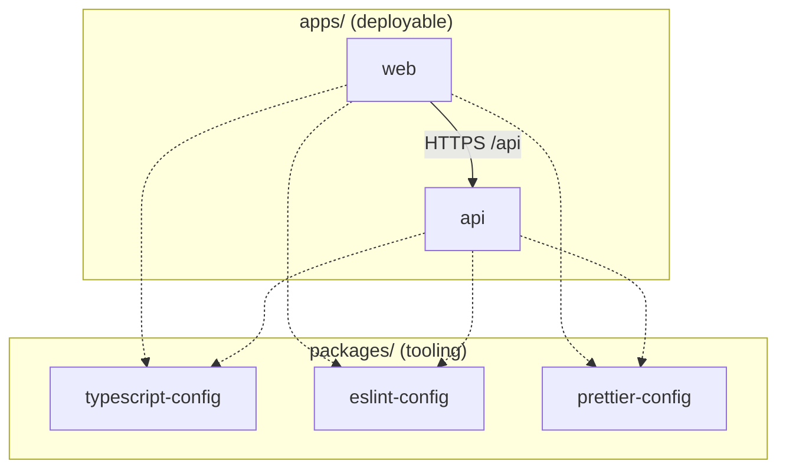
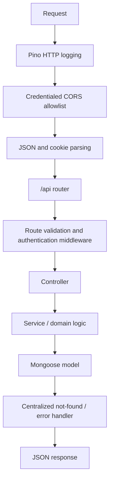
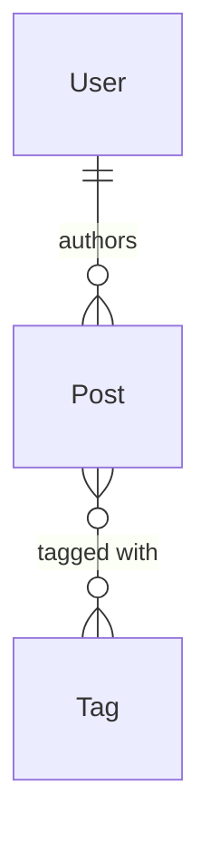
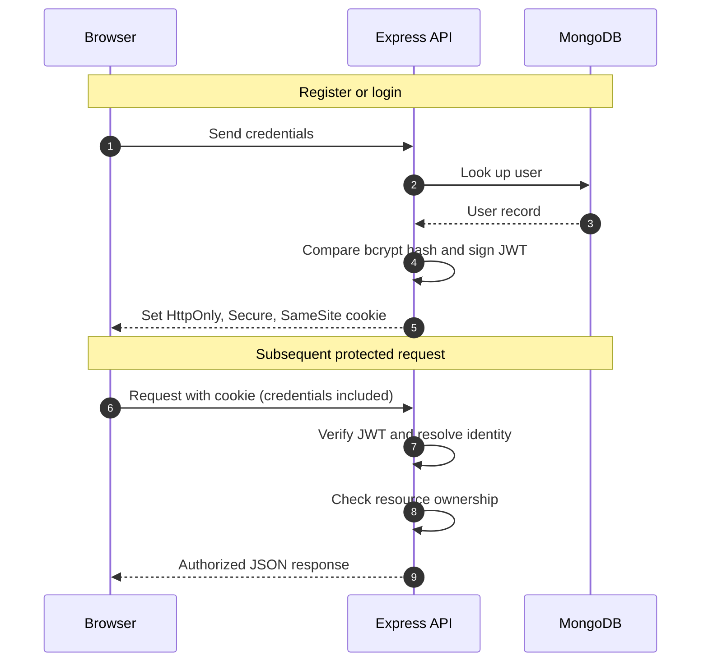
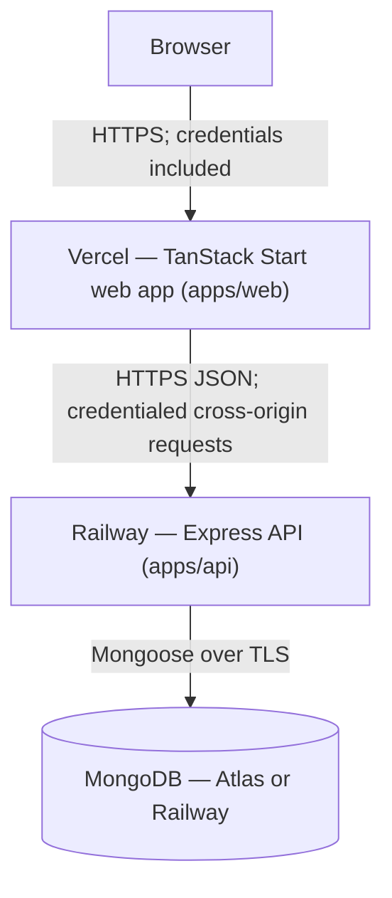

# Architecture

## Purpose

This document defines the target architecture for Hashnode Clone. It distinguishes the **current bootstrap state** from the planned MVP so agents do not treat unimplemented features as existing behaviour.

> [!NOTE]
> Everything below is the target design unless it appears under [Current state](#current-state). Product features are not implemented yet.

## Current state

- `apps/web` is a TanStack Start shell with generated file-based routing, TanStack Query integration, Tailwind CSS, and one shadcn/ui button.
- `apps/api` is an Express application with MongoDB connection management, Zod environment parsing, credentialed CORS configuration, Pino logging, centralized error handling, and `GET /api/health`.
- No authentication, post, tag, profile, or production web-to-API feature is implemented yet.

## System context



TanStack Start owns UI routing, rendering, page metadata, and client/server data loading. Express remains the sole owner of business rules, validation, authorization, persistence, and the public REST contract. The browser and TanStack Start must never connect directly to MongoDB.

Public read pages may use TanStack Start loaders for server rendering and TanStack Query for cache hydration or client updates. Interactive, mutation-heavy, or freshness-sensitive data uses TanStack Query. Any authenticated server-side request to Express must deliberately forward the incoming cookie; browser requests must opt in to credential inclusion.

## Monorepo boundaries

```text
apps/
  web/                         Presentation and routing boundary
  api/                         REST, authorization, domain, and persistence boundary
packages/
  eslint-config/               Shared lint configuration only
  prettier-config/             Shared formatting configuration only
  shared/                      Shared API contract types only
  typescript-config/           Shared compiler configuration only
```



Dependencies flow inward through declared workspace dependencies. Applications must not import another app’s source via relative paths. Shared runtime code may be extracted into a new package only when both applications genuinely need it.

Turborepo coordinates package scripts. Root scripts delegate using `turbo run`; application-specific script logic belongs in each app’s `package.json`.

## Web architecture (`apps/web`)

### Responsibilities

- File-based routes and layouts through TanStack Router
- Page rendering and document metadata through TanStack Start
- Server state, cache invalidation, mutations, loading, and error states through TanStack Query
- Accessible interface composition with shadcn/ui and Tailwind CSS
- Markdown input, safe rendering, and code highlighting
- Client-side display of authentication state derived from the session endpoint

### Target route map

TanStack Router file names will use its `$param` convention while preserving the PRD URLs.

| URL            | Proposed route file      | Access                            |
| -------------- | ------------------------ | --------------------------------- |
| `/`            | `routes/index.tsx`       | Public                            |
| `/post/:slug`  | `routes/post/$slug.tsx`  | Public                            |
| `/tag/:slug`   | `routes/tag/$slug.tsx`   | Public                            |
| `/login`       | `routes/login.tsx`       | Guest-only                        |
| `/register`    | `routes/register.tsx`    | Guest-only                        |
| `/dashboard`   | `routes/dashboard.tsx`   | Protected                         |
| `/editor/new`  | `routes/editor/new.tsx`  | Protected                         |
| `/editor/:id`  | `routes/editor/$id.tsx`  | Protected; API enforces ownership |
| `/profile/:id` | `routes/profile/$id.tsx` | Public                            |
| `/settings`    | `routes/settings.tsx`    | Protected                         |

Route guards improve user experience but are not an authorization boundary. Protected loaders and components should redirect unauthenticated users to `/login`; Express independently verifies every protected request.

### UI and state boundaries

| Concern                                         | Owner                                                       |
| ----------------------------------------------- | ----------------------------------------------------------- |
| Route parameters and search state               | TanStack Router                                             |
| Remote data, mutations, cache, and invalidation | TanStack Query                                              |
| Auth/session identity                           | A small app-level session provider backed by `/api/auth/me` |
| Form draft and editor interaction               | Route/component local state                                 |
| Reusable UI primitives                          | `src/components/ui`                                         |
| Feature components                              | Feature-local components, promoted only when reused         |

The JWT is not readable by JavaScript. The client derives signed-in state from the authenticated user response rather than storing a token in application state.

## API architecture (`apps/api`)

### Request pipeline



### Target module layout

```text
src/
  config/                      Database, CORS, logger, shared clients
  controllers/                 HTTP request/response orchestration
  middlewares/                 Authentication, validation, errors
  models/                      Mongoose User, Post, and Tag schemas
  routes/                      Versionless REST endpoint registration
  services/                    Reusable domain operations
  utils/                       Slug, cookie, and response helpers
  env.ts                       Parsed environment configuration
  app.ts                       Express application composition
  index.ts                     Database connection and process lifecycle
```

Controllers must remain thin: parse validated input, call domain services, and translate known failures into HTTP responses. Models own schema constraints and database indexes; services own multi-model operations such as post/tag linking and ownership checks.

## Data model



| Model  | Core fields and constraints                                                                                                                                         |
| ------ | ------------------------------------------------------------------------------------------------------------------------------------------------------------------- |
| `User` | Required name; unique lowercased email; bcrypt password hash; bio max 200; avatar URL; timestamps                                                                   |
| `Post` | Required title, Markdown content, unique slug, excerpt max 250, optional cover image, draft/published status, required author reference, tag references, timestamps |
| `Tag`  | Unique lowercased name and unique slug; timestamps                                                                                                                  |

Query rules are part of the data-access design: public queries filter to `status: "published"`; dashboard queries filter by the authenticated author and include drafts; edit/delete operations compare the authenticated user id with `post.author` before mutation.

## REST contract

`/api` is the API prefix. See [PRD.md](./PRD.md#rest-api-contract) for the complete endpoint table.

| Resource | Public reads                                  | Protected actions                                                                                     |
| -------- | --------------------------------------------- | ----------------------------------------------------------------------------------------------------- |
| Auth     | —                                             | Register/login establish a session; `GET /auth/me` returns session identity; logout clears the cookie |
| Posts    | Feed, detail by slug, tags                    | Create, current-user list, update/delete own post                                                     |
| Tags     | List with published counts; posts by tag slug | Tag creation occurs as part of authorized post editing                                                |
| Users    | Public profile and published posts            | Update own profile                                                                                    |

API responses must never include a password hash or other sensitive server-only values.

## Authentication and security

### JWT session flow



- Cookies are `HttpOnly` so application JavaScript cannot read the JWT.
- Production cookies require `Secure`; the final `SameSite` policy must match the deployed web/API origin topology.
- CORS uses an explicit `CORS_ORIGIN` allowlist and credentials. Wildcard origins are invalid with credentialed cookies.
- Authentication proves identity; authorization determines whether that identity may act on a resource. Never rely on hidden UI controls for authorization.
- Validate request bodies with Zod, enforce Mongoose constraints, return safe errors, and sanitize or safely render Markdown-derived HTML.
- Use rate limiting and security headers as a later hardening step before deployment.

> [!IMPORTANT]
> Route guards and hidden UI are user-experience aids only. The API must verify the JWT and resource ownership on every protected request; drafts must never be returned by public endpoints.

## Content rendering flow

1. The editor stores raw Markdown in `Post.content`.
2. The API persists raw Markdown, not rendered HTML.
3. The web app renders Markdown through a safe renderer.
4. Fenced code blocks are highlighted by declared language using Highlight.js.
5. Rendering configuration must prevent unsafe HTML/script execution from user content.

## Environment configuration

Environment files belong to the application that consumes them and must not be committed.

| App        | Current variables                                                                                        | Purpose                                                                      |
| ---------- | -------------------------------------------------------------------------------------------------------- | ---------------------------------------------------------------------------- |
| `apps/api` | `NODE_ENV`, `PORT`, `LOG_LEVEL`, `MONGO_URI`, `CORS_ORIGIN`, `HTTP_TIMEOUT_MS`, optional `HTTP_BASE_URL` | API runtime, database, logging, CORS, outbound HTTP                          |
| `apps/web` | None defined yet                                                                                         | Add only public, non-secret configuration when the API client is implemented |

Authentication implementation will add a server-only JWT signing secret to `apps/api/.env` and its `.env.example` documentation. It must never be exposed to the web app or committed to the repository.

## Intentional PRD deviations

| PRD recommendation                         | Repository decision       | Reason                                                   |
| ------------------------------------------ | ------------------------- | -------------------------------------------------------- |
| JavaScript only                            | TypeScript                | Safer contracts across routes, API, and schemas          |
| Vite React SPA                             | TanStack Start            | File-based routing and optional SSR/data-loading support |
| React Router and Context-only server state | TanStack Router and Query | Type-safe routes and purpose-built remote-state handling |
| Two standalone folders                     | pnpm/Turborepo monorepo   | Shared tooling and clear package boundaries              |
| JWT in localStorage bearer header          | JWT in HttpOnly cookie    | Reduces client-side token exposure                       |

These decisions preserve the required user stories and do not relax the pass conditions: password hashing, server-side ownership checks, draft isolation, and reproducible local setup.

## Deployment topology

> [!IMPORTANT]
> Deployment is **planned, not done**. The project is not yet deployed; the topology below describes the intended target.

Deployment is intentionally deferred until the MVP works locally. The planned production topology is:



| Component        | Host                             | Build / runtime notes                                                                |
| ---------------- | -------------------------------- | ------------------------------------------------------------------------------------ |
| Web (`apps/web`) | Vercel                           | TanStack Start compiles via Nitro; use the `vercel` preset for the deployment target |
| API (`apps/api`) | Railway                          | `tsdown` bundles the API; run the emitted Node server with production variables      |
| Database         | MongoDB Atlas or Railway MongoDB | Managed service; the local Docker container is development-only                      |

### Cross-origin cookie implications

Vercel and Railway serve different origins, so the deployment is cross-site:

- The API cookie must be `HttpOnly`, `Secure`, and `SameSite=None` in production.
- `CORS_ORIGIN` on the API must whitelist the exact Vercel domain; credentialed CORS is invalid with wildcards.
- Browser requests to the API must include credentials, and any server-side request that needs the session must forward the incoming cookie deliberately.
- Both hosts must serve over HTTPS for `Secure` cookies to be accepted.

Production environment values stay in each host’s configuration and are never committed. `apps/api` receives server-only values such as `MONGO_URI`, `CORS_ORIGIN`, the JWT signing secret, and `NODE_ENV=production`; `apps/web` receives only the public API base URL.
