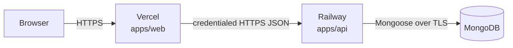

# Hashnode Clone

A full-stack developer blogging platform inspired by Hashnode. Authors write Markdown posts with code blocks, organize them with tags, save drafts, publish articles, and manage their profiles. Readers browse a public feed, search posts, explore tags, and view author profiles.

> [!NOTE]
> This is an individual full-stack internship project. The supplied requirements are summarized in [PRD.md](./PRD.md); the technical design is in [ARCHITECTURE.md](./ARCHITECTURE.md).

## Prerequisites

- Node.js `>= 24`
- pnpm `12.5.1`
- Docker Desktop (recommended for local MongoDB), or a MongoDB instance

## Local development

1. Install workspace dependencies:

   ```bash
   pnpm install
   ```

2. Create the API environment file:

   ```bash
   cp apps/api/.env.example apps/api/.env
   ```

3. Update `apps/api/.env` for local development. In particular, use the web dev-server origin:

   ```env
   MONGO_URI=mongodb://localhost:27017/hashnode
   CORS_ORIGIN=http://localhost:3000
   ```

4. Start MongoDB with Docker:

   ```bash
   pnpm --filter api db:up
   ```

5. Run all workspace development processes:

   ```bash
   pnpm dev
   ```

The web app runs on `http://localhost:3000`; the API defaults to `http://localhost:3001`. The current API health endpoint is `GET /api/health`.

To stop the local database:

```bash
pnpm --filter api db:down
```

## Useful commands

| Command                     | Purpose                           |
| --------------------------- | --------------------------------- |
| `pnpm dev`                  | Run workspace development tasks   |
| `pnpm build`                | Build all workspace applications  |
| `pnpm --filter api db:up`   | Start the local MongoDB container |
| `pnpm --filter api db:down` | Stop the local MongoDB container  |

## Authentication decision

The target implementation uses signed JWTs in secure HttpOnly cookies rather than localStorage. Browser API requests will include credentials, and the API will restrict credentialed CORS to explicitly configured origins. This reduces XSS exposure while retaining the PRD’s required authentication and server-side authorization behaviours.

## Deployment plan

> [!IMPORTANT]
> Deployment is **planned but not yet done**. The project is not currently deployed, and no production URLs or secrets are committed.

The project will be deployed after the MVP works locally, using:

| Component            | Target host                                  | Notes                                                                                     |
| -------------------- | -------------------------------------------- | ----------------------------------------------------------------------------------------- |
| Web app (`apps/web`) | [Vercel](https://vercel.com)                 | TanStack Start builds through Nitro; select the `vercel` preset for the deployment target |
| API (`apps/api`)     | [Railway](https://railway.com)               | Run the Express service from the compiled output with production environment variables    |
| Database             | MongoDB Atlas (or a Railway MongoDB service) | Managed instance, not the local Docker container                                          |



Vercel and Railway are separate origins, so the production cookie must use `SameSite=None; Secure` and the API’s `CORS_ORIGIN` must list the exact Vercel domain. No production URLs, secrets, or environment values are committed; the eventual deployment must use HTTPS, per-app environment variables, and a production MongoDB instance.

Planned production environment variables:

- `apps/api` (Railway): `NODE_ENV=production`, `MONGO_URI`, `CORS_ORIGIN=https://<vercel-domain>`, `LOG_LEVEL`, and a server-only JWT signing secret.
- `apps/web` (Vercel): the public API base URL used by the web app’s API client. No secrets.

See [ARCHITECTURE.md](./ARCHITECTURE.md#deployment-topology) for the full topology and cookie/CORS implications.

## Documentation

- [PRD.md](./PRD.md) — MVP scope, API contract, and evaluation constraints
- [ARCHITECTURE.md](./ARCHITECTURE.md) — System boundaries, data flows, security model, and package structure
- [PRD.pdf](./PRD.pdf) — Original supplied requirement document

## License

MIT. See [LICENSE](./LICENSE).
